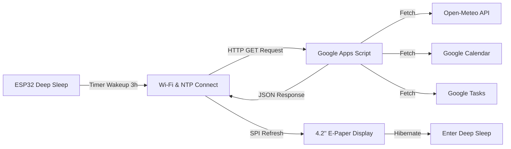

# ESP32 E-Paper Smart Dashboard

Un calendar și dashboard inteligent de birou, optimizat pentru consum ultra-redus de energie, bazat pe un microcontroller **ESP32** și un ecran **E-Paper de 4.2" (400x300)**.

Dashboard-ul agregă automat evenimentele din **Google Calendar**, task-urile din **Google Tasks**, zilele de naștere din agendă și prognoza meteo în timp real prin **Open-Meteo API**, utilizând un backend serverless securizat în **Google Apps Script**.

---

## Funcționalități Principale

- **Consum Ultra-Redus (Deep Sleep)**: Sistemul se trezește la fiecare 3 ore, descarcă datele, reîmprospătează ecranul și intră în hibernare completă (luni de autonomie pe baterie).
- **Vreme Inteligentă (Open-Meteo)**:
  - Dimineața (până la 13:00): Maxima zilei curente.
  - În timpul zilei (13:00 - 21:59): Temperatura și condițiile meteo live.
  - Noaptea (după 22:00): Maxima zilei următoare.
  - 6 pictograme grafice bitmap (Soare, Parțial Noros, Noros, Ploaie, Furtună, Ninsoare).
- **Orar Adaptiv (Google Calendar)**:
  - După ora 18:00 trece automat la orarul zilei următoare.
  - În weekend sare automat peste sâmbătă și duminică, afișând orarul de luni.
  - Aranjare vizuală inteligentă (centrare verticală și orizontală pentru 1–3 cursuri, listă ordonată pentru 4+ cursuri).
- **Listă de Task-uri (Google Tasks)**: Preluare directă a task-urilor nefinalizate din lista principală.
- **Zile de Naștere & Evenimente (Google Contacts)**: Detectare automată a aniversărilor pe următoarele 7 zile cu etichete prietenoase `(Azi!)` și `(mâine)`.
- **Securitate & Bune Practici**: Credențialele Wi-Fi și endpoint-urile Google Apps Script sunt separate în `config.h` și protejate strict prin `.gitignore`.

---

## Arhitectură Sistem



---

## Structura Proiectului

```
epaper/
├── .gitignore                          # Protecție pentru chei API, fișiere OS și build
├── LICENSE                             # Licență open-source MIT
├── README.md                           # Documentația principală a proiectului
├── docs/
│   └── hardware.md                     # Schema conexiunilor SPI și specificații hardware
├── firmware/
│   └── epaper_dashboard/
│       ├── epaper_dashboard.ino        # Sketch-ul principal Arduino/ESP32
│       ├── config.h.example            # Șablon de configurare (fără credențiale)
│       ├── config.h                    # Configurația locală (gitignored)
│       ├── icons.h                     # Bitmap-uri PROGMEM pentru meteo și layout
│       └── display_ui.h                # Modul modular de randare UI pe E-Paper
└── backend/
    └── google_apps_script/
        ├── Code.gs                     # Script serverless pentru agregare date
        ├── appsscript.json             # Manifest Google Apps Script (permisiuni)
        └── README.md                   # Ghid pas cu pas pentru deploiere Web App
```

---

## Hardware & Conexiuni

Ecranul E-Paper utilizează o interfață SPI standard. Conexiunile implicite pentru ESP32 sunt:

| Pin E-Paper | Semnal | Pin ESP32 | Descriere |
|:---:|:---:|:---:|:---|
| **VCC** | 3.3V | **3V3** | Alimentare logică 3.3V |
| **GND** | Masă | **GND** | Masă comună |
| **DIN / MOSI** | SPI MOSI | **GPIO 7** | Linie de date |
| **CLK / SCK** | SPI Clock | **GPIO 6** | Linie de ceas |
| **CS** | Chip Select | **GPIO 5** | Activ pe LOW |
| **DC** | Data / Command | **GPIO 4** | Selectare mod date/comandă |
| **RST** | Reset | **GPIO 2** | Reset hardware |
| **BUSY** | Stare Panou | **GPIO 15** | Semnal busy ecran |

Pentru detalii complete, consultați [Ghidul Hardware](docs/hardware.md).

---

## Biblioteci Arduino Necesare

Pentru compilarea firmware-ului sunt necesare următoarele biblioteci din *Arduino Library Manager*:
- **GxEPD2** (de Jean-Marc Zingg) - Driver pentru e-paper
- **U8g2_for_Adafruit_GFX** (de olikraus) - Suport fonturi UTF-8 și diacritice
- **ArduinoJson** (v7.x recomandat, de Benoît Blanchon) - Parsare JSON de mare viteză

---

## Ghid Rapid de Pornire

### 1. Configurare Backend (Google Apps Script)
1. Urmează instrucțiunile din [Backend Setup](backend/google_apps_script/README.md).
2. Deploiază scriptul ca **Web App** (Access: `Anyone`).
3. Copiază adresa URL a Web App-ului.

### 2. Configurare Firmware
1. Mergi în directorul `firmware/epaper_dashboard/`:
   ```bash
   cd firmware/epaper_dashboard
   ```
2. Creează fișierul `config.h` pornind de la șablon:
   ```bash
   cp config.h.example config.h
   ```
3. Editează `config.h` și completează credențialele tale:
   ```cpp
   const char* const WIFI_SSID     = "Numele_Retelei_Tale";
   const char* const WIFI_PASSWORD = "Parola_Ta_WiFi";
   const char* const API_URL       = "https://script.google.com/macros/s/DEPLOYMENT_ID/exec";
   ```

### 3. Compilare și Încărcare
1. Deschide fișierul `firmware/epaper_dashboard/epaper_dashboard.ino` în **Arduino IDE** (sau VSCode cu PlatformIO).
2. Selectează placa ESP32 corespunzătoare și portul serial.
3. Apasă pe **Upload**.
4. Monitorul serial (115200 baud) va afișa pașii de conectare Wi-Fi, preluare date și randare.

---

## Securitate & Bune Practici

- **Fără secrete în repository**: Fișierul `config.h` este inclus în `.gitignore`. Nu îl adăugați manual cu `git add -f`.
- **Verificare înainte de commit**: Folosiți `git status` pentru a vă asigura că niciun fișier local de configurare nu este pregătit pentru commit.

---

## Licență

Acest proiect este licențiat sub termenii licenței [MIT](LICENSE).
